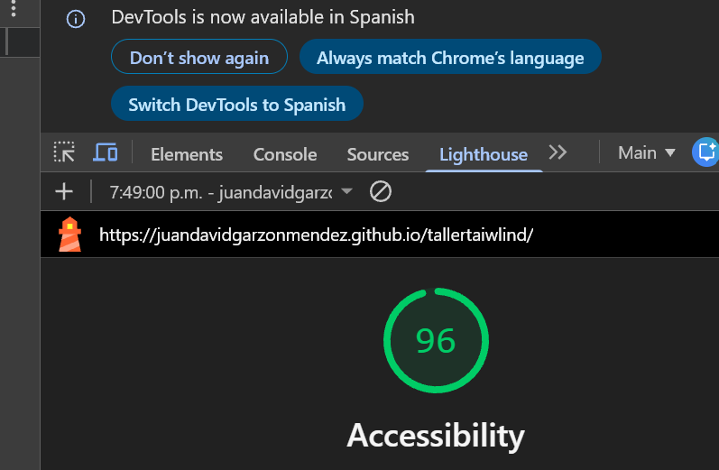

# Portafolio personal | Juan David Garzón Méndez

Landing page de un portafolio personal como desarrollador de software, creada con HTML, Tailwind CSS 4 y JavaScript puro, con ayuda de inteligencia artificial. Es el trabajo individual **"Investigación y desarrollo de un sitio web con Tailwind CSS e inteligencia artificial"** del seminario *Gestión de Software Ágil Asistido por Inteligencia Artificial* (Fundación Escuela Tecnológica de Neiva, FET, Programa de Ingeniería de Software).

- **Sitio publicado:** https://juandavidgarzonmendez.github.io/tallertaiwlind/
- **Repositorio:** https://github.com/JuanDavidGarzonMendez/tallertaiwlind
- **Autor:** Juan David Garzón Méndez
- **Docente:** ING. Camilo Morales Vargas
- **Fecha:** 22 de octubre de 2026

## Temática y público

El sitio presenta quién soy, mis proyectos y una forma de contactarme. Está dirigido a reclutadores, empresas locales y docentes que quieran conocer mi trabajo. El propósito es mostrar mis proyectos y recibir mensajes por medio de un formulario.

## Tecnologías

- HTML5 semántico
- Tailwind CSS 4 mediante el Play CDN (`https://cdn.jsdelivr.net/npm/@tailwindcss/browser@4`)
- JavaScript puro, sin librerías ni frameworks
- Google Fonts: Space Grotesk (títulos) e Inter (textos)
- Imágenes de ejemplo de Unsplash

## Secciones y funciones

| Sección | Qué incluye |
|---|---|
| Navbar fija | Logo en texto, enlaces, botón "Contáctame", botón de modo claro/oscuro y menú hamburguesa en celular (se cierra con un enlace o con Escape) |
| Hero | Título principal, subtítulo, imagen y dos botones |
| Sobre mí | Texto, imagen y lista de habilidades |
| Proyectos | Tarjetas en grid (1 columna en celular, 2 en tablet y 3 en computador) con efecto hover |
| Modal | Ventana con el detalle de cada proyecto (etiqueta `<dialog>`, se cierra con el botón, con Escape o al hacer clic fuera) |
| Formación | Tarjetas con mi formación académica |
| Preguntas frecuentes | Acordeón de 4 preguntas |
| Contacto | Formulario con validación de campos obligatorios y de correo, mensajes de error junto al campo y toast de confirmación que desaparece a los 4 segundos |
| Pie de página | Correo, GitHub, ubicación y derechos reservados |

## Diseño

### Paleta (regla 60-30-10)

| Rol | Modo claro | Modo oscuro |
|---|---|---|
| Dominante (60 %) | `#F8FAFC` | `#0F172A` |
| Secundario (30 %) | `#1E293B` | `#E2E8F0` |
| Acento (10 %) | `#0F766E` | `#2DD4BF` |
| Éxito | `#15803D` | `#15803D` |
| Error | `#B91C1C` | `#FCA5A5` |
| Advertencia | `#B45309` | `#B45309` |

Los colores se definen con `@theme` dentro de `<style type="text/tailwindcss">`, y el modo oscuro usa `@custom-variant dark` con la clase `dark` en el elemento raíz.

### Contraste (cálculo con la fórmula de WCAG)

| Combinación | Relación |
|---|---|
| Texto sobre fondo claro | 14.0:1 |
| Texto claro sobre botón de acento | 5.2:1 |
| Texto sobre fondo oscuro | 14.5:1 |
| Texto oscuro sobre botón de acento (modo oscuro) | 9.6:1 |
| Texto blanco sobre el verde de éxito | 5.0:1 |
| Rojo de error sobre fondo claro | 6.2:1 |
| Botón de acento en hover, claro / oscuro | 7.2:1 / 12.1:1 |

El mínimo exigido es 4.5:1 (WCAG 2.1, nivel AA).

### Tipografía

Jerarquía: H1 `text-4xl md:text-5xl font-bold`, H2 `text-3xl font-semibold`, H3 `text-xl font-semibold`, párrafos `text-base leading-relaxed` y textos pequeños `text-sm`.

### Accesibilidad

- Texto alternativo descriptivo en todas las imágenes, con `width` y `height` para evitar saltos de diseño
- `label` asociada a cada campo del formulario
- Foco visible con `focus-visible:ring` en botones, enlaces y campos
- `aria-expanded` y `aria-label` dinámico en el menú; `aria-expanded` y `aria-controls` en el acordeón
- `aria-live` en los mensajes de error y `aria-invalid` en los campos con error
- `role="status"` en el toast
- HTML semántico (`header`, `nav`, `main`, `section`, `footer`) y un solo `h1`

### Heurísticas de Nielsen aplicadas

- **Visibilidad del estado del sistema:** el toast confirma el envío, y el acordeón y el menú indican si están abiertos.
- **Prevención y recuperación de errores:** el formulario valida los campos y explica cada error junto al campo.
- **Consistencia:** los botones, tarjetas y enlaces comparten los mismos colores, bordes y estados hover y focus.
- **Control y libertad del usuario:** el menú y el modal se pueden cerrar de varias formas.

## Bitácora de prompts

**Versión 1:** prompt maestro con las cinco partes (rol, contexto, tareas, restricciones y formato de salida), enviado a la herramienta de IA, que entregó el archivo `index.html` inicial.

Prompt maestro completo (ver texto)

**ROL:**
Actúa como desarrollador frontend senior especializado en Tailwind CSS 4, diseño responsive, accesibilidad web (WCAG AA) y JavaScript puro. Además, eres mentor de estudiantes de Ingeniería de Software: escribes código sencillo, corto y fácil de entender, porque el estudiante debe poder explicar cada línea en un video.

**CONTEXTO:**
Voy a crear mi portafolio personal como desarrollador de software. Soy Juan David Garzón Méndez, estudiante de Ingeniería de Software de la Fundación Escuela Tecnológica de Neiva (FET), en Neiva, Huila, Colombia. El público objetivo son reclutadores, empresas locales y docentes que quieren conocer mis proyectos y contactarme. El objetivo del sitio es presentar quién soy, mostrar mis proyectos y recibir mensajes por medio de un formulario de contacto. El tono es profesional pero cercano. No conoces mis datos reales: usa marcadores entre corchetes como [PROYECTO 1], [DESCRIPCIÓN], [CORREO] o [AÑO] y NO inventes empresas, logros, cifras ni tecnologías que no te haya dado.

**TAREAS:**
Construye una página de una sola página (landing) con estas secciones, en este orden:
1. Navbar fija con logo en texto, enlaces a cada sección, botón de modo claro/oscuro y botón "Contáctame". En celular se convierte en menú hamburguesa que se abre y se cierra con JavaScript, y también se cierra al hacer clic en un enlace. El botón hamburguesa debe actualizar aria-expanded.
2. Hero con título principal, subtítulo, una imagen o ilustración y dos botones: "Ver proyectos" y "Contáctame".
3. Sección "Sobre mí" con texto e imagen en dos columnas (una columna en celular) y una lista corta de habilidades [HABILIDADES].
4. Proyectos en tarjetas con grid de 1 columna en celular, 2 en tablet y 3 en computador. Cada tarjeta lleva imagen, nombre, descripción corta, etiquetas de tecnologías, efecto hover y un botón "Ver detalle" que abre un modal con más información del proyecto (componente extra). El modal debe usar la etiqueta `<dialog>`, cerrarse con un botón y con la tecla Escape.
5. Preguntas frecuentes en acordeón (4 preguntas) que se abren y se cierran con JavaScript, con aria-expanded en cada botón.
6. Formulario de contacto con nombre, correo, asunto y mensaje. Cada campo tiene su label. Valida con JavaScript que los campos obligatorios estén llenos y que el correo sea válido; muestra el error en rojo debajo de cada campo y, al enviar correctamente, un toast verde de confirmación (con role="status") que desaparece a los 4 segundos y limpia el formulario.
7. Pie de página con correo [CORREO], enlaces a [GITHUB] y [LINKEDIN], ubicación (Neiva, Huila) y derechos reservados con el año.

Agrega un botón para cambiar entre modo claro y modo oscuro usando la variante dark de Tailwind.

**RESTRICCIONES:**
- Tecnologías: solo HTML, Tailwind CSS 4 mediante el Play CDN (https://cdn.jsdelivr.net/npm/@tailwindcss/browser@4) y JavaScript puro, sin otras librerías ni frameworks.
- Tema: define la paleta con @theme dentro de una etiqueta `<style type="text/tailwindcss">` siguiendo la regla 60-30-10: dominante #F8FAFC para fondos (60 %), secundario #1E293B para textos y bloques (30 %) y acento #0F766E para botones y detalles (10 %). Colores semánticos: éxito #15803D, error #B91C1C y advertencia #B45309. Nombra los colores en español (por ejemplo bg-dominante, text-secundario, bg-acento, text-error) y úsalos en todo el sitio en lugar de colores sueltos.
- Modo oscuro: en la misma etiqueta de estilo agrega @custom-variant dark (&:where(.dark, .dark *)); y alterna la clase "dark" en document.documentElement con el botón. En modo oscuro conserva la proporción 60-30-10 con colores oscuros equivalentes.
- Tipografía: máximo dos fuentes de Google Fonts, Space Grotesk para títulos e Inter para textos, definidas con @theme (font-titulo y font-texto). Jerarquía clara: H1 text-4xl md:text-5xl font-bold, H2 text-3xl font-semibold, H3 text-xl font-semibold, párrafos text-base leading-relaxed y textos pequeños text-sm.
- Responsive: diseño mobile-first y uso de al menos los prefijos sm:, md: y lg:. Debe verse bien en celular, tablet y computador.
- Accesibilidad: texto alternativo descriptivo en todas las imágenes, contraste mínimo de 4.5:1 en texto normal (también en modo oscuro), etiquetas en todos los campos, foco visible con focus-visible:ring en botones, enlaces y campos (nunca quites el contorno sin reemplazarlo), HTML semántico (header, nav, main, section, footer) y un solo H1.
- Estados: hover y focus visibles en botones, enlaces y tarjetas, con transiciones suaves.
- Código: sencillo, lo más corto posible y SIN COMENTARIOS, escrito como lo haría un estudiante: nombres de variables y funciones en español, const y function, addEventListener, sin patrones avanzados ni clases de JavaScript. No construyas nombres de clase de Tailwind dinámicamente. Usa solo clases que existan en Tailwind 4; si dudas de una clase, usa otra más simple.
- No inventes datos: usa los marcadores entre corchetes que te indiqué.

**FORMATO DE SALIDA:**
Entrega un único archivo index.html completo, con el `<style type="text/tailwindcss">` en el head, el código indentado y el JavaScript al final del body, sin comentarios. Usa imágenes de ejemplo de un banco gratuito (por ejemplo Unsplash) con su alt. Después del código, agrega una lista corta (máximo 6 puntos) que explique cómo abrir el archivo y qué marcadores debo reemplazar. No agregues introducción ni despedida.

Prompts de ajuste enviados a Claude (Anthropic) el 22 de octubre de 2026:

- **Prompt A:** "https://juandavidgarzonmendez.github.io/tallertaiwlind/ revisa el sitio"
- **Prompt B:** "aquí tienes el código revisa las falencias y corrige ya corregí algunas cosas" (con el `index.html` adjunto)

Prompts C a G (ver texto completo)

**Prompt C:** Te adjunto mi index.html. Problema: el botón del menú hamburguesa siempre tiene aria-label="Abrir menú", aunque el menú esté abierto. Haz que diga "Cerrar menú" cuando el menú esté abierto y "Abrir menú" cuando esté cerrado, también cuando se cierra al hacer clic en un enlace. Cambia solo esa parte del JavaScript, sin tocar estilos ni otras funciones. Código sencillo, estilo estudiante, sin comentarios. Devuélveme solo el fragmento modificado e indica dónde pegarlo.

**Prompt D:** Te adjunto mi index.html. Problema: el menú móvil no se cierra con la tecla Escape. Agrega un evento de teclado que cierre el menú con Escape y actualice aria-expanded y el aria-label del botón. No cambies estilos ni otras funciones. Código sencillo, sin comentarios. Devuélveme solo el fragmento nuevo e indica dónde pegarlo.

**Prompt E:** Te adjunto mi index.html. Problema: los botones del acordeón de preguntas frecuentes no tienen aria-controls que los relacione con su respuesta. Agrega un id único a cada respuesta y el aria-controls correspondiente en cada botón, sin cambiar las clases de Tailwind ni la lógica de abrir y cerrar. Código sencillo, sin comentarios. Devuélveme solo la sección de preguntas frecuentes modificada.

**Prompt F:** Te adjunto mi index.html. Problema: las imágenes no tienen width ni height, lo que provoca saltos de diseño al cargar. Agrega width y height proporcionales (900x600 para las dos imágenes grandes y 800x533 para las de las tarjetas) a cada etiqueta img, sin cambiar las clases de Tailwind, los alt ni loading="lazy". Devuélveme solo las etiquetas img modificadas.

**Prompt G:** Te adjunto mi index.html. Problema: el modal de detalle solo se cierra con el botón Cerrar o con Escape. Haz que también se cierre al hacer clic fuera del contenido (en el fondo oscuro). Cambia solo el JavaScript del modal, sin tocar el HTML ni los estilos. Código sencillo, sin comentarios. Devuélveme solo el fragmento nuevo e indica dónde pegarlo.

| # | Prompt de ajuste enviado | Problema que buscaba resolver | Resultado obtenido | ¿Funcionó? |
|---|---|---|---|---|
| 1 | Prompt A | El sitio publicado mostraba textos de ejemplo sin reemplazar (`[PROYECTO 1]`, `[DESCRIPCIÓN CORTA]`, `[CORREO]`) y parecía una plantilla | La IA listó todos los marcadores pendientes; yo reemplacé proyectos, habilidades y correo con mis datos | Sí |
| 2 | Prompt B | Las preguntas frecuentes seguían con marcadores, con numeración mezclada y solo 3 de las 4 preguntas | Quedaron 4 preguntas con sus respuestas | Sí |
| 3 | Prompt B | Los enlaces del pie de página estaban rotos (`[GITHUB]`, `[LINKEDIN]`, `mailto:[CORREO]`) | Correo y GitHub corregidos; se retiró el enlace de LinkedIn hasta tener mi dirección | Sí, con LinkedIn pendiente |
| 4 | Prompt B | Al pasar el mouse, los botones perdían contraste y en modo oscuro el hover no cambiaba | Se agregaron dos colores a `@theme` (`acento-hover` y `acento-hover-oscuro`) y se aplicaron con `hover:` y `dark:hover:`; contraste de 7.2:1 y 12.1:1 | Sí |
| 5 | Prompt B | Los mensajes de error del formulario no se anunciaban a lectores de pantalla | Se agregó `aria-live="polite"` a los mensajes y `aria-invalid` a los campos desde el JavaScript | Sí |
| 6 | Prompt B | En el modal el año quedaba pegado al texto ("MySQL.2023"), había errores de redacción ("4 semestre") y las imágenes no tenían carga diferida | Texto corregido ("Año: 2023", "cuarto semestre"), `loading="lazy"` en las imágenes de más abajo y `meta description` | Sí |
| 7 | Prompt C | El botón del menú siempre decía "Abrir menú", aunque estuviera abierto | El `aria-label` cambia a "Cerrar menú" al abrir y vuelve a "Abrir menú" al cerrar o al elegir un enlace | Sí |
| 8 | Prompt D | El menú móvil no se cerraba con la tecla Escape | Un evento de teclado cierra el menú y actualiza `aria-expanded` y el `aria-label` | Sí |
| 9 | Prompt E | Los botones del acordeón no estaban relacionados con su respuesta | Cada respuesta tiene un `id` (`respuesta-1` a `respuesta-4`) y cada botón el `aria-controls` correspondiente | Sí |
| 10 | Prompt F | Las imágenes sin `width` ni `height` provocaban saltos de diseño | Se agregaron las dimensiones (900x600 y 800x533) sin cambiar las clases ni el `alt` | Sí |
| 11 | Prompt G | El modal solo se cerraba con el botón o con Escape | Ahora también se cierra al hacer clic fuera de la caja; un clic dentro no lo cierra | Sí |

Todos los ajustes se probaron abriendo el sitio y comprobando cada interacción (menú, modo oscuro, modal con Escape, botón y clic fuera, acordeón, errores del formulario y toast que desaparece a los 4 segundos).

## Cambios hechos a mano (sin IA)

| # | Cambio | Dónde | Por qué |
|---|---|---|---|
| 1 | El símbolo del acordeón cambia de "+" a "−" cuando la respuesta está abierta | JavaScript, en el evento `click` de `.pregunta` | Mejora la visibilidad del estado del sistema (Nielsen): se ve si la pregunta está abierta o cerrada |
| 2 | El modo oscuro se guarda con `localStorage` y se aplica al cargar la página | JavaScript, en el botón de tema y al inicio del script | La preferencia del visitante no se pierde al recargar la página |
| 3 | Nueva sección "Formación" con su enlace en la navbar | HTML: una `<section>` nueva antes de "Preguntas frecuentes" y un `<li>` nuevo en el menú | Amplía el contenido del portafolio y practica la estructura de secciones y las clases de Tailwind |

## Revisión y pruebas

- **Responsive:** probado en celular, tablet y computador con las herramientas de desarrollador del navegador.
- **Validador HTML (validator.w3.org):** 3 errores y 0 advertencias. Los 3 errores vienen del uso del Play CDN de Tailwind CSS 4: el validador no reconoce `type="text/tailwindcss"` en la etiqueta `<style>` ni las reglas `@theme` y `@custom-variant`. El taller exige este método, y en un proyecto real se evitarían compilando el CSS con Tailwind CLI. Se corrigió la advertencia de encabezado vacío en el modal, que ahora trae un texto inicial.
- **Lighthouse (accesibilidad):** 96/100 sobre el sitio publicado, en modo móvil (22 de octubre de 2026). Supera el mínimo de 90 que exige el taller.

## Cómo ejecutarlo

1. Descarga o clona este repositorio.
2. Abre `index.html` en el navegador (se necesita internet para cargar Tailwind, las fuentes y las imágenes).

## Uso de inteligencia artificial

La IA se usó como asistente para generar la versión inicial del código y para revisarlo y corregirlo, siguiendo la bitácora de arriba. Los cambios manuales están documentados en su sección, y el código fue revisado y probado antes de publicarlo.
